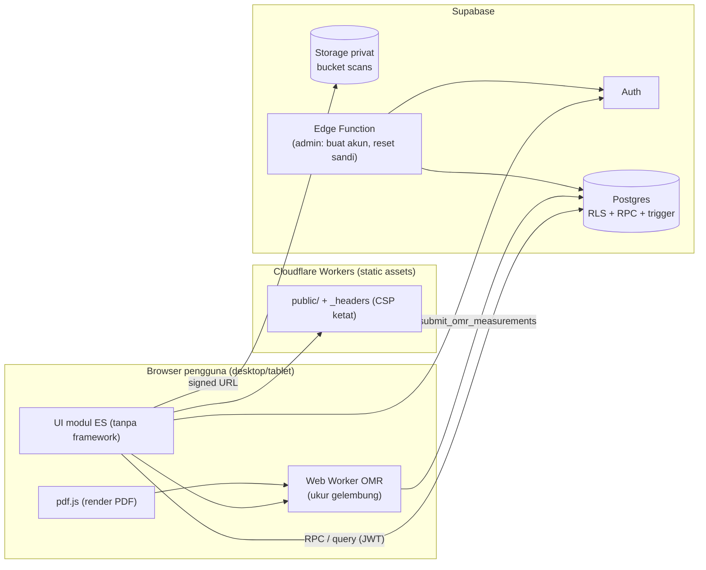
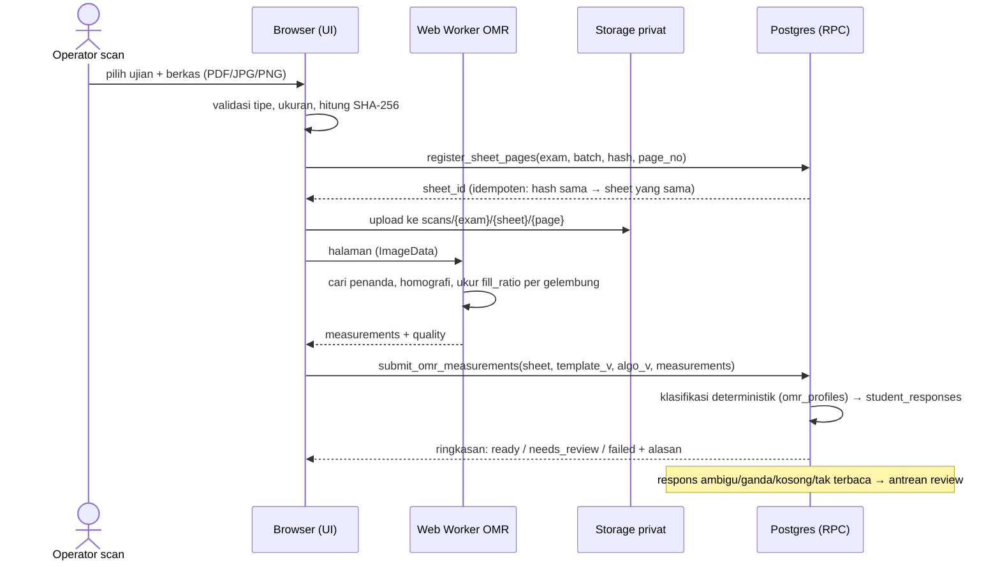
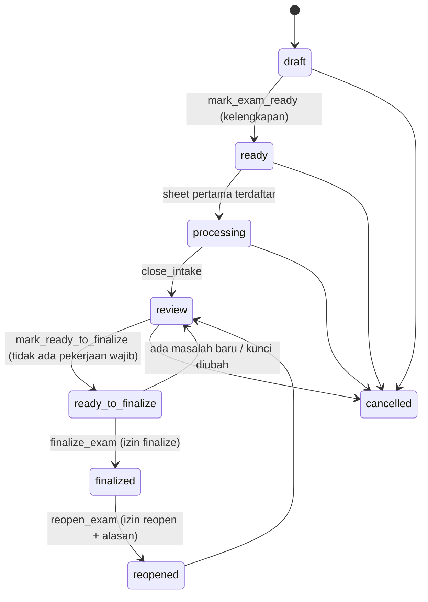
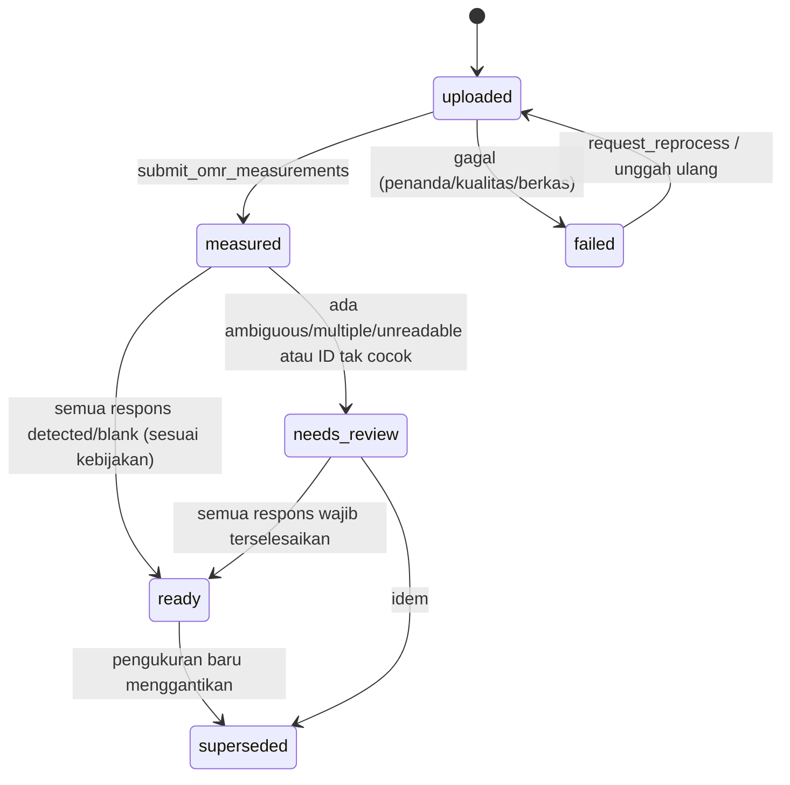

# Arsitektur (usulan untuk Gerbang 2)

Status: **diusulkan**. Mengikuti `docs/prd/05-ARSITEKTUR-TEKNIS.md`, ADR-0001 (stack), ADR-0002 (OMR), ADR-0003 (data).
Tidak ada kode yang ditulis sebelum Gerbang 1 dan 2 disetujui.

## 1. Komponen

- **Database adalah backend.** Semua keputusan bisnis ada di Postgres (RPC `security definer`,
  `set search_path = public, pg_temp`, constraint, trigger, RLS). Klien hanya menampilkan dan mengukur.
- **Cloudflare** hanya menyajikan aset statis. Tidak ada komputasi gambar di Workers/Edge Function (riset R1, R2).
- **Edge Function** hanya untuk tindakan admin yang butuh `service_role` (membuat akun staf, reset sandi), seperti FTS.
- **Service worker** hanya meng-cache aset statis; tidak pernah scan atau data (aturan #19).

## 2. Alur data: unggah → ukur → klasifikasi → review

Reprocessing: perubahan ambang → `reclassify_exam(exam_id)` di DB, **tanpa memuat ulang gambar**; baris
`locked_by_review = true` tidak disentuh. Kegagalan teknis (`failed`) tercatat dengan kode alasan dan dapat
diulang dari UI (`request_reprocess`).

## 3. State machine ujian

*Guard* per transisi didefinisikan di `docs/rpc-contracts.md`. Satu fungsi pusat `transition_exam` menegakkan
tabel transisi; kolom `status` tidak dapat diubah langsung oleh klien.

## 4. State machine lembar

## 5. Anggaran kapasitas dan kinerja (model; diukur di spike S1)

| Sumber daya | Batas (Free) | Perkiraan per ujian 300 siswa | Catatan |
|---|---|---|---|
| Storage scan | 1 GB | 120 MB (PG saja, 0,4 MB/hal.) – 360 MB (PG+esai 3 hal.) | Perlu purge/Pro; lihat riset §2 |
| Database | 500 MB | ≈ 2 MB respons + audit | Tidak jadi kendala |
| Egress | 5 GB | ≈ 720 MB (2 kali lihat) | Cache + signed URL dipakai ulang |
| Memori dekode browser | — | 35–48 MB/halaman | Proses 1 halaman per Worker, tidak paralel tanpa batas |
| Waktu per lembar | — | **belum diukur** | Target ditetapkan setelah S1; jangan janjikan angka |

Aturan kinerja UI: semua daftar dipaginasi dan difilter di server; antrean review memuat gambar halaman
berikutnya secara *prefetch* (satu di depan) agar berpindah cepat tanpa memboroskan egress.

## 6. Lingkungan dan penyebaran

| Lingkungan | Isi | Catatan |
|---|---|---|
| Lokal | Postgres 16 sungguhan untuk tes DB/RLS, build statis | Sama seperti FTS (`scripts/test-db.sh`) |
| Staging | Proyek Supabase + deployment Cloudflare terpisah | Migrasi diuji dulu di sini; akun uji ber-sandi di-generate |
| Produksi | Proyek Supabase produksi | Rollback: migrasi maju-saja + cadangan data (`backup.js` pola FTS) sebelum rilis |

Pencegahan jeda proyek Supabase Free: workflow `keepalive.yml` (pola FTS). Keputusan paket (Free/Pro) di D-03/D-14.

## 7. Batas dengan HRIS dan FTS

- Tidak ada tabel, kunci, atau fungsi HRIS/FTS yang diakses aplikasi ini.
- Rekomendasi D-03: **proyek Supabase terpisah** (data anak, scan, blast radius RLS). Biaya: kemungkinan Pro karena
  batas 2 proyek aktif di Free (R3); jumlah proyek yang sudah ada belum diketahui.
- SSO tidak dibuat di MVP (D-04). Akun staf dibuat admin; reset sandi oleh admin bila email tidak tersedia.
