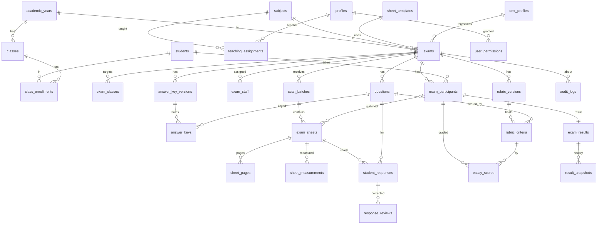

# Model data v2 (usulan untuk Gerbang 2)

Dasar: `docs/prd/06-DATABASE-SCHEMA.md` (22 entitas). Penyempurnaan dan alasannya di ADR-0003.
Ini **bukan migrasi**; migrasi ditulis setelah Gerbang 2. Tipe: `uuid` PK (`gen_random_uuid()`), `timestamptz`,
`numeric` untuk skor. Semua tabel punya `created_at`, `created_by`/`updated_at` bila relevan (diisi trigger).

## 1. ERD ringkas

## 2. Tabel (ringkas; kolom penting dan constraint)

### Identitas dan akses
| Tabel | Kolom/constraint penting |
|---|---|
| `profiles` | `id = auth.users.id`, `full_name`, `role` ∈ {admin_akademik, guru, pemeriksa, pimpinan, operator_scan}, `is_active`. Trigger menolak perubahan `role`/`is_active` selain oleh admin. Default role terendah (`operator_scan` tanpa penugasan = tak ada akses data). |
| `user_permissions` | `user_id`, `permission` ∈ {finalize, reopen, amend_final, view_audit_all, manage_users}, `scope_exam_id` NULL=semua, `granted_by`, `granted_at`, `revoked_at`. Izin khusus (PRD "izin khusus") eksplisit dan terlacak. |
| `teaching_assignments` | `teacher_id`, `class_id`, `subject_id`, `academic_year_id`; unique gabungan. |
| `exam_staff` | `exam_id`, `user_id`, `duty` ∈ {owner, grader, scanner, viewer}; unique `(exam_id,user_id,duty)`. Penugasan per ujian untuk pemeriksa/operator. |

### Akademik
`academic_years(id, name, semester, starts_on, ends_on, is_active)`, `classes(id, academic_year_id, name, grade_level)`,
`students(id, student_code UNIQUE, full_name, is_active)`, `class_enrollments(student_id, class_id, UNIQUE satu kelas aktif per tahun ajaran)`,
`subjects(id, code UNIQUE, name)`. Data pribadi minimum (tanpa NIK/alamat/kontak).

### Ujian dan konfigurasi
| Tabel | Kolom/constraint penting |
|---|---|
| `exams` | `name`, `academic_year_id`, `subject_id`, `exam_date`, `status` enum (ADR-0003), `sheet_template_id`, `omr_profile_id`, `grading_config jsonb` (divalidasi: `pg_weight`+`essay_weight`=1 bila keduanya aktif; `blank_policy`, `multiple_policy`, `rounding`), `active_answer_key_version_id`, `active_rubric_version_id`, `blind_essay bool` (P1). CHECK bobot. |
| `exam_classes` | `exam_id`, `class_id` (opsional; peserta tetap dari `exam_participants`). |
| `exam_participants` | `exam_id`, `student_id`, `participant_code` (UNIQUE per ujian; memuat digit pemeriksa), `status` ∈ {active, absent, withdrawn, replacement}, `attempt_no` default 1. UNIQUE `(exam_id, student_id, attempt_no)`. Dibekukan saat `ready`. |
| `questions` | `exam_id`, `question_number`, `question_type` ∈ {multiple_choice, essay}, `option_count` (4/5), `max_score numeric`, `is_active`. UNIQUE `(exam_id, question_number)`. Teks soal tidak disimpan di MVP (D-21). |
| `answer_key_versions` | `exam_id`, `version_no`, `status` ∈ {draft, frozen}, `reason`, `frozen_by/at`. UNIQUE `(exam_id, version_no)`. |
| `answer_keys` | `version_id`, `question_id`, `correct_option` (A–E), `score numeric`; UNIQUE `(version_id, question_id)`. Tak dapat diubah bila versi `frozen` (trigger). |
| `rubric_versions` / `rubric_criteria` | Mirip kunci. Kriteria: `question_id`, `position`, `description`, `max_score`, `weight`. |
| `sheet_templates` | `code`, `version`, `layout jsonb` (lihat `omr-template-spec.md`), `effective_from`, `is_active`. UNIQUE `(code, version)`; `layout` tak dapat diubah setelah dipakai ujian. |
| `omr_profiles` | `name`, `version`, `thresholds jsonb` (`min_fill`, `dominance_ratio`, `ambiguous_band`, `min_quality`), `calibrated_on` (ref. dataset), `approved_by/at`. Tak dapat diubah setelah dipakai; revisi = versi baru. |

### Pemeriksaan
| Tabel | Kolom/constraint penting |
|---|---|
| `scan_batches` | `exam_id`, `label`, `uploaded_by`, `status`. |
| `exam_sheets` | `exam_id`, `batch_id`, `participant_id` NULL (belum cocok), `processing_status` ∈ {uploaded, measured, needs_review, ready, failed, superseded}, `failure_code`, `match_source` ∈ {omr, manual}. UNIQUE parsial: satu sheet aktif per `(exam_id, participant_id)` bila `participant_id` tidak NULL dan status ≠ superseded. |
| `sheet_pages` | `sheet_id`, `page_no`, `storage_path` (bukan URL), `file_hash` (SHA-256), `mime`, `bytes`, `purged_at`. UNIQUE `(exam_id, file_hash, page_no)` → idempotensi unggah. |
| `sheet_measurements` | `sheet_id`, `revision`, `template_id`, `algorithm_version`, `client_info`, `quality jsonb`, `id_bubbles jsonb`, `bubbles jsonb` (fill ratio per soal×opsi), `submitted_by/at`. Append-only; UNIQUE `(sheet_id, revision)`. |
| `student_responses` | `sheet_id`, `question_id`, `detected_answer`, `final_answer`, `response_status` ∈ {detected, blank, multiple, ambiguous, unreadable, manually_corrected}, `review_status` ∈ {not_required, pending, resolved}, `locked_by_review bool`, `score numeric`, `answer_key_version_id`. UNIQUE `(sheet_id, question_id)`. |
| `response_reviews` | `response_id`, `previous_value`, `new_value`, `reason`, `reviewed_by/at`. Append-only. |
| `essay_scores` | `participant_id`, `question_id`, `criterion_id`, `rubric_version_id`, `score numeric`, `comment`, `status` ∈ {draft, completed}, `graded_by/at`. CHECK `0 ≤ score ≤ max_score` (via trigger/join karena max di tabel lain). UNIQUE `(participant_id, criterion_id)`. |

### Hasil dan audit
| Tabel | Kolom/constraint penting |
|---|---|
| `exam_results` | `exam_id`, `participant_id` (UNIQUE), `pg_raw`, `pg_max`, `pg_score`, `essay_raw`, `essay_max`, `essay_score`, `final_score`, `status` ∈ {provisional, complete, finalized}, `exceptions jsonb`. Hanya ditulis oleh fungsi hitung. |
| `result_snapshots` | `exam_id`, `participant_id`, `revision`, `final_score` + komponen, `grading_config` salinan, `answer_key_version_id`, `rubric_version_id`, `event` ∈ {finalize, amend, reopen}, `actor`, `reason`, `created_at`. **Append-only** (trigger menolak UPDATE/DELETE). |
| `audit_logs` | `actor_user_id`, `action`, `entity_type`, `entity_id`, `exam_id`, `before_data`, `after_data`, `reason`, `request_id`, `created_at`. Append-only. Tanpa data pribadi berlebih (pakai ID, bukan nama). |

## 3. Indeks yang diperlukan (minimum)

- `student_responses(sheet_id)`, parsial `(sheet_id) WHERE review_status='pending'` untuk antrean.
- `exam_sheets(exam_id, processing_status)`; `exam_sheets(exam_id, participant_id)`.
- `sheet_pages(exam_id, file_hash)`.
- `essay_scores(participant_id)`, `(question_id, status)`.
- `audit_logs(exam_id, created_at DESC)`, `(entity_type, entity_id)`.
- `exam_participants(exam_id, participant_code)`.

## 4. Aturan integritas yang dijaga database

1. Kunci/rubrik/sheet_template/omr_profile yang `frozen`/terpakai tidak dapat diubah; revisi = versi baru.
2. `grading_config` hanya berubah pada `draft`; bobot valid (CHECK).
3. Skor esai dalam rentang; skor PG dari kunci versi aktif; nilai hanya ditulis fungsi hitung.
4. Transisi status hanya melalui `transition_exam`; kolom aktor diisi trigger.
5. `result_snapshots`, `audit_logs`, `response_reviews`, `sheet_measurements` append-only.
6. FK `ON DELETE RESTRICT`; tidak ada hard delete data akademik/hasil.
7. Kode peserta memuat digit pemeriksa (Luhn); kode yang gagal pemeriksaan ditolak saat impor dan ditandai saat OMR.

## 5. Kebutuhan data yang masih bergantung keputusan

D-07 (struktur `participant_code`), D-08/D-09 (isi `grading_config`), D-12 (ukuran tabel, partisi tidak diperlukan
pada skala ini), D-14 (kolom `purged_at` dan jadwal purge), D-21 (apakah `question_options` dibangun).
