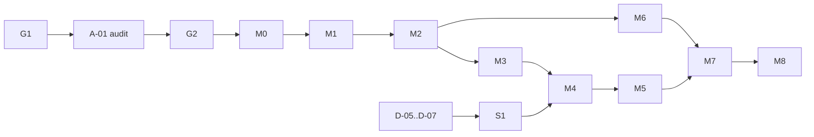

# Rencana kerja (usulan)

Menyusun ulang `docs/prd/12-IMPLEMENTATION-BACKLOG.md` (Epic A–G) menjadi modul berurutan dengan dependensi,
gerbang, dan jalur kritis. Ukuran adalah **usaha relatif**, bukan janji tanggal: S ≈ sampai 2 hari, M ≈ 3–5 hari,
L ≈ 1–2 minggu untuk satu pengembang. Roadmap PRD (`docs/prd/10-ROADMAP.md`) memperkirakan ±7–9 minggu total; urutan
di bawah tidak mengubah itu secara material, kecuali paralelisasi spike OMR yang dapat menghemat sekitar satu minggu
**bila D-05..D-07 dijawab lebih awal**. Kapasitas tim dan tanggal ujian (D-16) belum diketahui.

## 1. Gerbang

| Gerbang | Isi | Keluaran | Status |
|---|---|---|---|
| G1 | PRD dan lingkup MVP | `decisions.md` §C | menunggu |
| A-01 | Audit repo HRIS/FTS | `HRIS-ARCHITECTURE-NOTES.md` | belum |
| G2 | Arsitektur, data, izin, RPC, ancaman, tes | `decisions.md` §D | usulan sudah disusun, menunggu G1 |
| S1 | Spike OMR | `omr-spike-report.md`, ADR-0002 final | menunggu D-05..D-07 |
| G3 | Foundation (M0) | tes hijau, CI, staging | belum |

## 2. Modul

| Modul | Cakupan (backlog) | Bergantung pada | Ukuran | Keluaran utama / kriteria keluar |
|---|---|---|---|---|
| **M0 Foundation** | A-03, A-04, G-01 (dasar) | G2 | L | Build + CSP + SW; CI; harness tes DB; migrasi dasar; `profiles`/role + trigger penjaga; `audit_logs`; Edge Function buat-akun/reset-sandi; `keepalive`; login. **Keluar:** T-01, T-03, T-16, T-17 hijau |
| **M1 Data akademik** | B-01..B-05 | M0 | L | Tahun ajaran, kelas, siswa, mapel, penugasan; impor CSV berpratinjau dan validasi. **Keluar:** role berbeda hanya melihat data yang diizinkan |
| **M2 Ujian & konfigurasi** | C-01..C-07 | M1 | L | Ujian, peserta + kode bercek-digit, soal PG, kunci berversi, rubrik berversi, `grading_config`, registri template & profil OMR, `transition_exam`, `mark_exam_ready`. **Keluar:** ujian dapat disiapkan dan dibekukan tanpa scan |
| **S1 Spike OMR** | D-04, D-05 (prototipe), D-10 | D-05..D-07, perangkat (D-20) | M (≈ 5 hari) | Laporan + ADR-0002 final + `omr_profiles` v1. **Dapat berjalan paralel dengan M0–M2** |
| **M3 Intake & storage** | D-01..D-03 | M2 | M | Bucket privat + policy, `register_sheet_pages` idempoten, UI unggah, status/antrean, batas kuota, rancangan purge (D-14). **Keluar:** T-07..T-09, T-20, AC-03 |
| **M4 OMR produksi** | D-05, D-09 | S1, M3 | L | Modul pengukuran terbukti (versi S1), `submit_omr_measurements`, klasifikasi DB, `reclassify_exam`, pencocokan peserta. **Keluar:** metrik pilot tercatat; AC-04 |
| **M5 Review OMR** | D-06..D-08 | M4 | L | Antrean, viewer berdampingan (zoom/putar/halaman), pintasan papan ketik, riwayat koreksi, prefetch. **Keluar:** pemeriksa dapat menyelesaikan satu kelas tanpa mouse berlebih (uji pengguna) |
| **M6 Esai** | E-01..E-06 | M2, M3 (scan tersedia) | M | Antrean esai, viewer scan + rubrik, skor per kriteria, draf/selesai. **Paralel dengan M4–M5.** **Keluar:** AC-05 |
| **M7 Nilai, finalisasi, laporan** | F-01..F-08 | M5, M6 | L | `compute_exam_results`, guard finalisasi, `finalize/reopen/amend`, `result_snapshots`, laporan, CSV+XLSX. **Keluar:** AC-06, AC-07; semua kasus formula §test-strategy hijau |
| **M8 Keamanan, pilot, rilis** | G-02..G-08 | M7 | L | Matriks RLS lengkap (T-01..T-20), review keamanan independen, latihan restore, e2e, pilot satu ujian, panduan, purge terjadwal, keputusan go-live. **Keluar:** gate pilot `09-TEST-PLAN.md` §4 |

Dependensi (ringkas):

**Jalur kritis:** D-05..D-07 → S1 → M4 → M5 → M7 → M8. Risiko jadwal terbesar ada di S1 dan M4 (OMR); hasilnya
tidak bisa dijanjikan sebelum diuji.

## 3. Urutan kerja yang disarankan

1. Jawab keputusan di `decisions.md` §A (terutama D-12, D-16, D-03, D-05..D-07).
2. Setujui G1; jalankan A-01 (audit FTS/HRIS) dan G2.
3. Mulai M0; **bersamaan** siapkan bahan S1 (cetak template uji, kumpulkan lembar, siapkan perangkat) dan jalankan S1
   segera setelah D-05..D-07 siap, tanpa menunggu M1/M2.
4. Setiap modul: mini-plan → tes dulu → review kode → review keamanan (wajib untuk M0, M3, M7, M8) → e2e →
   verifikasi → laporan modul (SHIP / NEEDS WORK / BLOCKED), `STATE.md` diperbarui.
5. Pilot terbatas hanya setelah M8 dan telaah hukum D-17 untuk data nyata.

## 4. Definition of Ready (per issue)

Tujuan pengguna; konteks dan dependensi; acceptance criteria teruji (rujuk AC-xx / T-xx); kontrak data/RPC bila ada;
dampak keamanan dan RLS; definisi selesai. (Dari `12-IMPLEMENTATION-BACKLOG.md`.)

## 5. Setelah MVP (P1, tidak dibangun sebelum disetujui)

- Cetak lembar jawaban dari aplikasi dengan QR per siswa (D-07 tahap 2) memakai `jsqr.js`.
- Analisis butir soal: tingkat kesukaran `P = benar/peserta`; daya pembeda `D = (B_atas − B_bawah) / n_kelompok` dengan
  kelompok atas/bawah 27% menurut skor total. **Metodologi harus disetujui akademik sebelum dibangun** (PRD).
- Penilaian esai buta (D-18), peserta susulan (D-19), notifikasi, penugasan pemeriksa per kelompok soal,
  perbandingan antarkelas, mode foto ponsel bila gate terpisah lulus.
